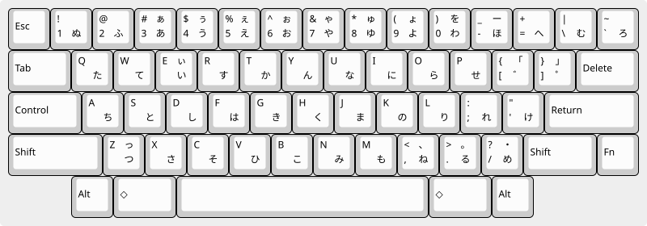
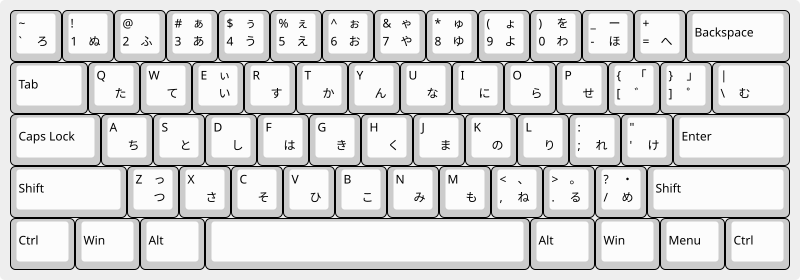

# uskana+ttcode

## 概要

Google 日本語入力で **親指漢直 (USかな + TT-code)** を使うための設定ファイルのセットです。

- ひらがなは USかな入力 (USキーボード上の JISかな入力) で、
- 漢字は `SPC` (スペースキー) シフトにより TT-code (漢字直接入力 T-code の拡張) で、

それぞれ入力します。
カタカナは、ひらがなで入力してカタカナ変換するか TT-code で入力します。

## 動作環境

- US配列のキーボード (QWERTY)
- macOS + [Karabiner-Elements](https://karabiner-elements.pqrs.org/)
- [Google 日本語入力](https://www.google.co.jp/ime/)

## 設定ファイル

- [uskana+ttcode.json](uskana+ttcode.json)
  - Karabiner-Elements 用の Complex Modifications 設定ファイル
  - `SPC` を漢直シフトとして使う (Google 日本語入力使用中のみ) ための設定です
  - `SPC` が押されている間に打鍵されたキーに `|` (VERTICAL LINE) を前置します
- [uskana+ttcode.romantable.txt](uskana+ttcode.romantable.txt)
  - Google 日本語入力用のローマ字テーブル
  - `|` の付いたキーは漢直シフトされた打鍵と解釈し、 TT-code のルールに従ってローマ字漢字変換します
  - それ以外のキーは通常打鍵として、 USかな配列に従ってローマ字かな変換します

## USかな

USかな配列は、JISかな配列を USキーボード用にアレンジしたものです。

`「`/`」` (かぎ括弧) は `[`/`]` (square bracket) に合わせて横並びに配置、 `ー` (長音記号) は `Shift+ほ` の位置にある `_` (underscore) で入力します。
`む` や `ろ` のキー `\` (backslash) や `` ` `` (grave accent) の位置は、キーボードによって異なるかもしれません。

### [Happy Hacking Keyboard](https://happyhackingkb.com/jp/) 英語配列

### 一般的な英語配列キーボード

## TT-code

[TT-Code](https://yoyuse.github.io/ttcode/) は [T-Code](http://openlab.jp/tcode/) の拡張の 1 つです。
T-Code の配列 (2 打鍵) はそのままで、 2 打鍵のプレフィックス (前置シフト) を 4 種導入し、 JIS漢字の第 2 水準までをカバーしています。

## 入力例

- `tu` → `かな`
- `SPC`-`l4z/` → `漢字`
- `tu` `SPC`-`l4z/j,` `d[l` `SPC`-`;l` → `かな漢字混じり文`
- `SPC`-`l4z/` `w[` `SPC`-`k;` `gqe` `SPC`-`cx` `d[` → `漢字で書きたい感じ`

## 参考サイト

- [「親指漢直」とは何か？(1) - 錬金術師の実験室](https://web.archive.org/web/20211204133509/http://homeposition.net/~m%28as%29m/blog/2015/08/whats-oyayubi-kanchoku-1.html)
- [DvorakJとGoogle日本語入力の連携による各種キー配列への対応 - 錬金術師の実験室](https://web.archive.org/web/20211204141027/http://homeposition.net/~m%28as%29m/blog/2015/12/15-advent.html)
